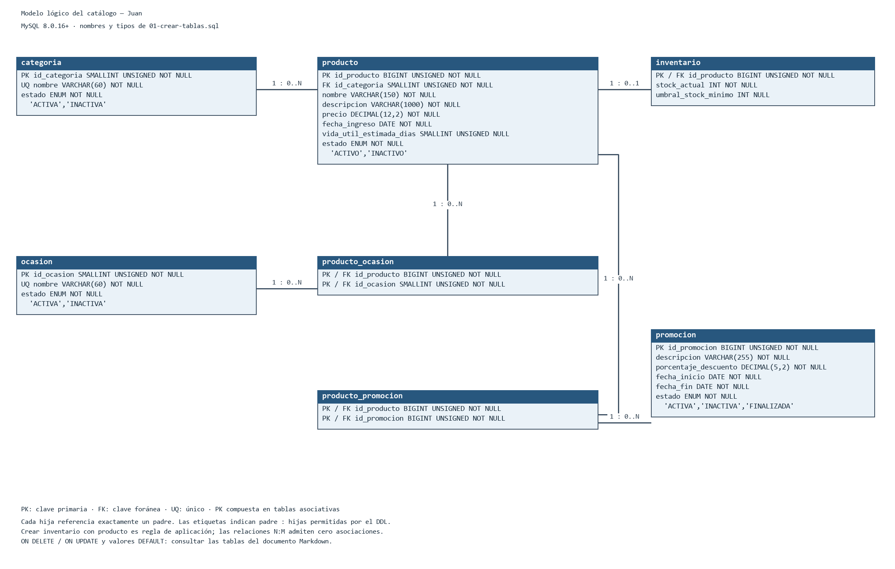

# Análisis del catálogo para el modelo de datos

Categorías productos ocasiones y promociones

Fase 4 Base de datos 
Sistema de Tienda Virtual para Floristería 
Responsable: Juan Felipe 
Septiembre de 2026

Propósito. Este aporte define la parte del catálogo que Juan debe entregar a Iván. La propuesta transforma los requisitos RF-007 a RF-018 y las clases existentes en tablas normalizadas, con claves, relaciones y reglas suficientes para integrarlas con el modelo conceptual general.

## Conclusión del análisis

El módulo requiere seis tablas: cuatro tablas principales y dos tablas asociativas. `categoria` clasifica a `producto` en una relación 1:N. `producto` se relaciona con `ocasion` y `promocion` mediante `producto_ocasion` y `producto_promocion` (N:M). El diseño queda en tercera forma normal. La integración incorpora `inventario` como referencia externa para conservar el stock sin duplicarlo en `producto`; se prioriza la desactivación para conservar la historia.

## Tablas propuestas

### Categoría

Organiza los productos del catálogo. Una categoría puede clasificar muchos productos y cada producto pertenece a una categoría.

| Campo | Tipo SQL | Clave | Nulo | Regla |
| --- | --- | --- | --- | --- |
| id_categoria | SMALLINT UNSIGNED | PK | No | Identificador autogenerado |
| nombre | VARCHAR(60) | UQ | No | UNIQUE; no vacío tras TRIM; colación utf8mb4_0900_ai_ci |
| estado | ENUM('ACTIVA','INACTIVA') | — | No | Valores del ENUM; DEFAULT 'ACTIVA' |

### Producto

Representa cada artículo ofrecido por la floristería. Conserva precio, estado, fecha de ingreso y vida útil para alertas de vencimiento. La disponibilidad y las alertas de stock se consultan en `inventario`, donde residen `stock_actual` y `umbral_stock_minimo`.

| Campo | Tipo SQL | Clave | Nulo | Regla |
| --- | --- | --- | --- | --- |
| id_producto | BIGINT UNSIGNED | PK | No | Identificador autogenerado |
| id_categoria | SMALLINT UNSIGNED | FK | No | Referencia `categoria.id_categoria` |
| nombre | VARCHAR(150) | — | No | Nombre comercial |
| descripcion | VARCHAR(1000) | — | No | Descripción visible en el catálogo |
| precio | DECIMAL(12,2) | — | No | Mayor que cero |
| fecha_ingreso | DATE | — | No | Fecha de entrada inicial |
| vida_util_estimada_dias | SMALLINT UNSIGNED | — | Sí | NULL o mayor que cero |
| estado | ENUM('ACTIVO','INACTIVO') | — | No | Valores del ENUM; DEFAULT 'ACTIVO' |

### Inventario como referencia de integración

Los dos atributos de existencias del aporte original se conservan en `inventario`, según la decisión de integración del equipo. `id_producto` es PK y FK; no se agregan columnas de stock a `producto`.

| Campo | Tipo SQL | Clave | Nulo | Regla |
| --- | --- | --- | --- | --- |
| id_producto | BIGINT UNSIGNED | PK, FK | No | Referencia `producto.id_producto` |
| stock_actual | INT | — | No | Cero o mayor; solo cambia por movimientos |
| umbral_stock_minimo | INT | — | Sí | Cero o mayor; nulo desactiva la alerta |

### Ocasión

Permite filtrar productos por motivo de compra, como cumpleaños, aniversario o condolencias. Se añade el estado porque RF-012 exige que las ocasiones puedan desactivarse.

| Campo | Tipo SQL | Clave | Nulo | Regla |
| --- | --- | --- | --- | --- |
| id_ocasion | SMALLINT UNSIGNED | PK | No | Identificador autogenerado |
| nombre | VARCHAR(60) | UQ | No | UNIQUE; no vacío tras TRIM; colación utf8mb4_0900_ai_ci |
| estado | ENUM('ACTIVA','INACTIVA') | — | No | Valores del ENUM; DEFAULT 'ACTIVA' |

### Promoción

Define un descuento con periodo de vigencia y puede aplicarse a uno o varios productos. La asociación se conserva para consultar promociones pasadas.

| Campo | Tipo SQL | Clave | Nulo | Regla |
| --- | --- | --- | --- | --- |
| id_promocion | BIGINT UNSIGNED | PK | No | Identificador autogenerado |
| descripcion | VARCHAR(255) | — | No | Descripción de la promoción |
| porcentaje_descuento | DECIMAL(5,2) | — | No | Mayor que 0 y máximo 100 |
| fecha_inicio | DATE | — | No | Inicio de vigencia |
| fecha_fin | DATE | — | No | Igual o posterior a fecha_inicio |
| estado | ENUM('ACTIVA','INACTIVA','FINALIZADA') | — | No | Valores del ENUM; DEFAULT 'ACTIVA' |

## Tablas asociativas

| Tabla | Campos | Propósito y clave |
| --- | --- | --- |
| producto_ocasion | id_producto, id_ocasion | Resuelve la relación muchos a muchos. La PK compuesta impide repetir la misma asociación. |
| producto_promocion | id_producto, id_promocion | Resuelve la relación muchos a muchos. La PK compuesta impide duplicados. |

## Relaciones y cardinalidades

| Origen | Relación | Destino | Cardinalidad |
| --- | --- | --- | --- |
| categoria | clasifica | producto | 1 : 0..N |
| producto | se asocia mediante producto_ocasion | ocasion | N a M |
| producto | se asocia mediante producto_promocion | promocion | N a M |

## Reglas que debe conservar la base de datos

- Solo los productos activos aparecen en el catálogo público.
- El precio debe ser mayor que cero y el stock nunca puede ser negativo.
- El stock no se modifica desde la edición del producto; cambia únicamente mediante movimientos de inventario.
- Desactivar productos, categorías u ocasiones no debe borrar su historial.
- Los nombres de categoría y ocasión son únicos con la colación `utf8mb4_0900_ai_ci`, que ignora mayúsculas y tildes. La aplicación debe normalizar espacios extremos; el `CHECK` solo impide nombres vacíos después de `TRIM`, y no almacena automáticamente el texto recortado.
- Una promoción debe tener un descuento válido y fecha final igual o posterior a la inicial.
- Un producto no puede tener dos promociones activas cuyos periodos se superpongan. Esta regla debe validarse en el servicio o mediante un disparador, porque una restricción UNIQUE simple no detecta cruces de fechas.
- Se prefiere desactivar categorías, ocasiones y promociones para conservar asociaciones históricas. El DDL restringe borrar una categoría usada por `producto` y una ocasión usada por `producto_ocasion`; borrar una promoción elimina sus filas de `producto_promocion` en cascada. Conservar estas últimas asociaciones exige la política de desactivación de la aplicación.

## Validación de tercera forma normal

Primera forma normal: todos los campos contienen valores atómicos y no existen listas de ocasiones o promociones dentro de producto. Segunda forma normal: las tablas asociativas solo contienen claves completas y ninguna columna depende de una parte de la clave compuesta. Tercera forma normal: los datos de categoría, ocasión y promoción se almacenan en sus propias tablas; producto guarda únicamente la clave foránea de su categoría y no repite sus nombres o descripciones.

## Diagrama lógico del aporte

[Fuente editable del diagrama](modelo-logico-catalogo-juan.drawio)

Figura 1. Tablas y relaciones del módulo de catálogo.

## Entrega a Iván

Iván integra las seis tablas del catálogo al modelo conceptual general. El modelo físico de Roman ya define sus tipos y restricciones en MySQL 8.0.16+. Se conserva la regla de no superposición de promociones activas como validación pendiente del servicio, procedimiento o disparador; el DDL actual no la impone.

## Referencia SQL y alcance de la sincronización

La fuente física es [01-crear-tablas.sql](../scripts/01-crear-tablas.sql), contrastada con [02-datos-prueba.sql](../scripts/02-datos-prueba.sql) y [03-consultas.sql](../scripts/03-consultas.sql). El repositorio usa **MySQL 8.0.16+** y nombres en **singular y snake_case**. Los nombres de archivos siguen minúsculas y guiones según `CONTRIBUTING.md`. No se convierte el esquema a PostgreSQL ni se sustituyen nombres por plurales inexistentes.

PK = clave primaria; FK = clave foránea; UQ = restricción única. `1 : 0..N` expresa que cada fila hija tiene exactamente un padre, pero el padre puede no tener filas hijas. `1 : 0..1` limita a una fila hija opcional; la existencia obligatoria desde el padre requiere una operación de aplicación.

### Cambios frente a la propuesta original

| Tema | Propuesta Word | Definición vigente del SQL |
| --- | --- | --- |
| Identificadores de categoría y ocasión | BIGINT | SMALLINT UNSIGNED |
| Nombres de categoría y ocasión | VARCHAR(100) | VARCHAR(60) |
| Identificadores de producto y promoción | BIGINT | BIGINT UNSIGNED, también en las tablas asociativas |
| Descripción de promoción | VARCHAR(500) | VARCHAR(255) |
| Vida útil | INT obligatorio | SMALLINT UNSIGNED NULL; si existe debe ser mayor que cero |
| Estados | VARCHAR(15) | ENUM con los valores documentados en cada tabla |
| Stock y umbral | Atributos de producto | Atributos de inventario; se conserva su significado y nulabilidad |
| Eliminación de promoción | Propuesta de restringir asociaciones históricas | CASCADE en producto_promocion; conservar historia mediante desactivación |

### Tipos y claves de las tablas asociativas

#### producto_ocasion

| Campo | Tipo SQL | Clave | Nulo | Regla |
| --- | --- | --- | --- | --- |
| id_producto | BIGINT UNSIGNED | PK, FK | No | Referencia `producto.id_producto` |
| id_ocasion | SMALLINT UNSIGNED | PK, FK | No | Referencia `ocasion.id_ocasion` |

#### producto_promocion

| Campo | Tipo SQL | Clave | Nulo | Regla |
| --- | --- | --- | --- | --- |
| id_producto | BIGINT UNSIGNED | PK, FK | No | Referencia `producto.id_producto` |
| id_promocion | BIGINT UNSIGNED | PK, FK | No | Referencia `promocion.id_promocion` |

### Acciones referenciales implementadas

| Tabla hija | FK | Tabla padre y PK | ON DELETE | ON UPDATE |
| --- | --- | --- | --- | --- |
| producto | id_categoria | categoria.id_categoria | RESTRICT | CASCADE |
| producto_ocasion | id_producto | producto.id_producto | CASCADE | CASCADE |
| producto_ocasion | id_ocasion | ocasion.id_ocasion | RESTRICT | CASCADE |
| producto_promocion | id_producto | producto.id_producto | CASCADE | CASCADE |
| producto_promocion | id_promocion | promocion.id_promocion | CASCADE | CASCADE |
| inventario | id_producto | producto.id_producto | RESTRICT | CASCADE |

### Cardinalidades verificadas

| Padre | Hija | Cardinalidad del DDL | Participación de la hija |
| --- | --- | --- | --- |
| categoria | producto | 1 : 0..N | Una categoría obligatoria por producto |
| producto | producto_ocasion | 1 : 0..N | Un producto obligatorio por asociación |
| ocasion | producto_ocasion | 1 : 0..N | Una ocasión obligatoria por asociación |
| producto | producto_promocion | 1 : 0..N | Un producto obligatorio por asociación |
| promocion | producto_promocion | 1 : 0..N | Una promoción obligatoria por asociación |
| producto | inventario | 1 : 0..1 | Un producto obligatorio por fila de inventario |

Las PK compuestas son `(id_producto, id_ocasion)` y `(id_producto, id_promocion)`. Las dos relaciones N:M permiten cero asociaciones en ambos extremos. La PK/FK de `inventario` impide más de una fila por producto, pero no crea esa fila automáticamente: el negocio exige crear el inventario junto con el producto.

### Reglas que corresponden a la aplicación

El DDL comprueba precio positivo, stock no negativo, umbral nulo o no negativo, vida útil nula o positiva, porcentaje de descuento mayor que cero y no superior a 100, y fechas de promoción ordenadas. La aplicación filtra productos activos, normaliza espacios, modifica el stock mediante movimientos y evita promociones activas superpuestas. Estas últimas operaciones no están implementadas como triggers en los scripts existentes. La desactivación conserva registros; no debe confundirse con un DELETE físico.
