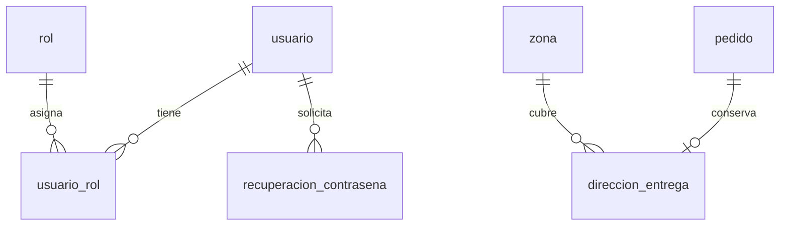
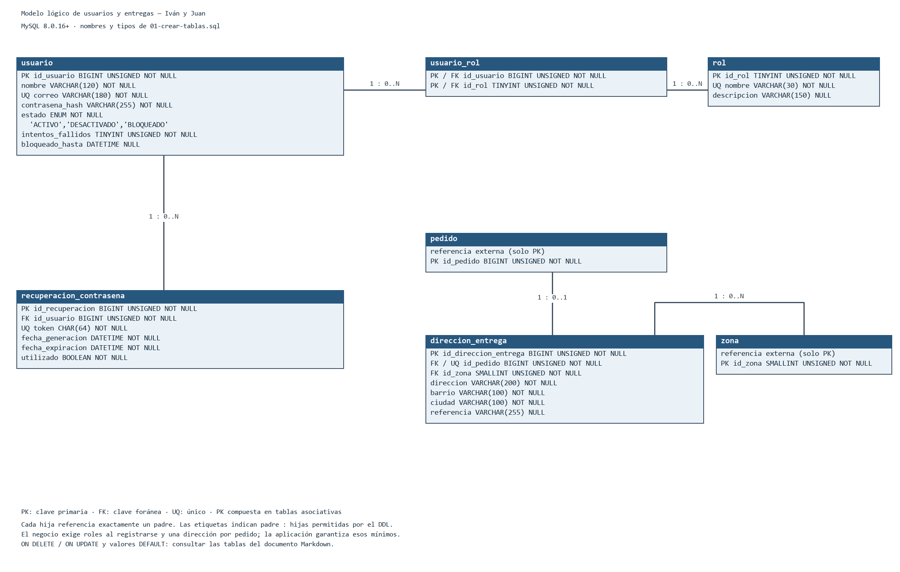

# Modelo conceptual y lógico de base de datos

Fase 4 del proyecto

Componentes de Iván y Juan alineados con los requerimientos de la Fase 2

Responsables: Iván y Juan

Documento editable para integración con el equipo

Fecha: 16 de septiembre de 2026

## Introducción

Este documento integra el modelo conceptual elaborado por Iván y su transformación en un modelo lógico normalizado desarrollada por Juan para la Fase 4 del proyecto. El componente se encuentra alineado con los requerimientos de la Fase 2 y define la información de usuarios, roles, recuperación de contraseña y direcciones de entrega, junto con sus claves, relaciones, cardinalidades y reglas de integridad.

## Objetivo

Identificar las entidades y relaciones del componente asignado y transformarlas en un esquema lógico normalizado hasta tercera forma normal, listo para su integración con el modelo físico y los scripts SQL.

## Alcance de la responsabilidad

La responsabilidad de Iván comprende el análisis conceptual de usuario, rol, recuperacion_contrasena y direccion_entrega, además de usuario_rol como entidad asociativa. La responsabilidad de Juan comprende su transformación lógica: definición de atributos atómicos, claves primarias, claves foráneas, claves candidatas, nulabilidad y dependencias funcionales, con validación hasta 3FN. pedido y zona se conservan como referencias externas para la integración global.

## Base de trazabilidad

El modelo incorpora RF-001 a RF-006, RF-023 y las reglas RN-G2, RN-G6 y RN-01 a RN-06, RN-22, RN-23, RN-30 a RN-35. Las entidades pedido y zona forman parte de la integración global y se muestran solo como referencias necesarias para la dirección de entrega.

## Entidades identificadas

| Entidad | Propósito |
| --- | --- |
| usuario | Representa a las personas registradas que utilizan el sistema. |
| rol | Clasifica las funciones que puede desempeñar una cuenta. |
| usuario_rol | Registra la asignación de uno o varios roles a un usuario. |
| recuperacion_contrasena | Registra solicitudes seguras de recuperación de acceso. |
| direccion_entrega | Conserva la dirección de entrega propia de cada pedido. |

## Descripción de entidades y atributos

### usuario

Almacena las cuentas registradas. Las cuentas creadas desde el formulario público reciben el rol Cliente.

**Atributos**

| Atributo | Descripción |
| --- | --- |
| id_usuario | Identificador único del usuario. |
| nombre | Nombre utilizado para el registro. |
| correo | Correo electrónico de acceso. Debe ser único por cuenta. |
| contrasena_hash | Resultado del hash adaptativo con sal de la contraseña; no se almacena en texto plano. |
| estado | Indica si la cuenta se encuentra activa, desactivada o bloqueada temporalmente. |
| intentos_fallidos | Cantidad consecutiva de intentos de acceso no válidos. |
| bloqueado_hasta | Momento hasta el cual la cuenta permanece bloqueada temporalmente. |

**Clave primaria**

id_usuario

**Relaciones**

- Según los requisitos, un `usuario` debe tener uno o varios roles mediante `usuario_rol`. Las FK del DDL permiten cero o varias asignaciones: la asignación inicial del rol Cliente corresponde a la aplicación.
- Un usuario puede generar varias solicitudes de recuperacion_contrasena.

### rol

Define las funciones que puede desempeñar una cuenta dentro del sistema, por ejemplo Cliente, Empleado, Repartidor o Administrador.

**Atributos**

| Atributo | Descripción |
| --- | --- |
| id_rol | Identificador único del rol. |
| nombre | Nombre del rol. |
| descripcion | Descripción de la función asociada al rol. |

**Clave primaria**

id_rol

**Relaciones**

- Un rol puede estar asignado a varios usuarios mediante usuario_rol.

### usuario_rol

Entidad asociativa que resuelve la relación muchos a muchos entre usuario y rol.

**Atributos**

| Atributo | Descripción |
| --- | --- |
| id_usuario | Usuario al que se asigna el rol. |
| id_rol | Rol asignado al usuario. |

**Clave primaria**

id_usuario + id_rol (clave primaria compuesta)

**Relaciones**

- Cada registro de usuario_rol pertenece a un único usuario y a un único rol.
- Un usuario puede aparecer en varios registros y un rol puede estar presente en varios registros.

### recuperacion_contrasena

Registra las solicitudes realizadas por un usuario cuando necesita recuperar el acceso a su cuenta. El mecanismo no debe revelar si un correo existe en la plataforma.

**Atributos**

| Atributo | Descripción |
| --- | --- |
| id_recuperacion | Identificador único de la solicitud. |
| id_usuario | Usuario asociado a la solicitud. |
| token | Hash SHA-256 del token de recuperación; CHAR(64) con ascii_bin. |
| fecha_generacion | Fecha y hora en que se generó la solicitud. |
| fecha_expiracion | Fecha y hora límite de validez; el servicio fija 30 minutos y el DDL solo exige que sea posterior a fecha_generacion. |
| utilizado | Indica si el enlace ya fue utilizado. |

**Clave primaria**

id_recuperacion

**Relaciones**

- Cada recuperacion_contrasena pertenece a un usuario.
- Un usuario puede tener varias solicitudes de recuperación a lo largo del tiempo.
- Cada enlace de recuperación solo puede utilizarse una vez.

### direccion_entrega

Conserva la dirección de entrega de forma independiente para cada pedido, junto con los datos de comprador y destinatario que gestione la entidad pedido.

**Atributos**

| Atributo | Descripción |
| --- | --- |
| id_direccion_entrega | Identificador único de la dirección de entrega. |
| id_pedido | Pedido al que corresponde la dirección. |
| direccion | Dirección física de entrega. |
| barrio | Barrio donde se encuentra la entrega. |
| ciudad | Ciudad de la entrega. |
| referencia | Información adicional para facilitar la ubicación. |
| id_zona | Zona de cobertura a la que debe pertenecer la dirección. |

**Clave primaria**

id_direccion_entrega

**Relaciones**

- Cada direccion_entrega corresponde a un pedido.
- La dirección debe pertenecer a una zona de cobertura configurada.
- No se asume que la dirección haga parte permanente del perfil de un usuario.

## Relaciones y cardinalidades

| Entidad origen | Cardinalidad | Entidad relacionada | Descripción |
| --- | --- | --- | --- |
| usuario | 1 : 0..N | usuario_rol | El negocio exige uno o varios roles; el DDL admite cero o varias asignaciones por usuario. |
| rol | 1 : 0..N | usuario_rol | Un rol puede estar asignado a varios usuarios. |
| usuario | 1 : 0..N | recuperacion_contrasena | Un usuario puede generar varias solicitudes de recuperación. |
| pedido | 1 : 0..1 | direccion_entrega | El negocio exige una dirección por pedido; la FK UNIQUE admite cero o una desde pedido y exactamente un pedido desde dirección. |
| zona | 1 : 0..N | direccion_entrega | Una zona de cobertura puede corresponder a varias direcciones de entrega. |

## Modelo conceptual inicial

El siguiente esquema resume las entidades y relaciones del componente asignado. Los identificadores se muestran como claves primarias conceptuales y los campos de enlace se incluyen para facilitar la futura transformación al modelo lógico.

`pedido` y `zona` son referencias externas. El negocio exige una dirección por pedido; el DDL permite que aún no exista. Todos los atributos del esquema conceptual se conservan en las tablas anteriores y en el diagrama lógico completo.

## Entrega para integración con el equipo

Iván entrega este documento como insumo del componente conceptual. Para la integración del trabajo se deben compartir las siguientes definiciones:

- Entidades, atributos y claves primarias conceptuales documentados y trazados a los requerimientos de la Fase 2.
- Relación N:M entre usuario y rol, resuelta mediante la entidad asociativa usuario_rol.
- Reglas de seguridad relevantes: correo único, contraseña con hash adaptativo y sal, bloqueo temporal tras cinco intentos fallidos, y recuperación con duración de 30 minutos y uso único.
- Definición de direccion_entrega como información independiente de cada pedido y validada frente a zona.
- Base documental para que Juan transforme el modelo conceptual en un modelo lógico normalizado, y para que Ramón integre el modelo físico.
- Descripciones de cada entidad y atributo para que Stiven las incorpore y uniforme en diccionario-de-datos.md.

## Resumen de entrega

| Elemento | Estado |
| --- | --- |
| Entidades asignadas y asociativa | Documentadas |
| Atributos | Alineados con Fase 2 |
| Claves primarias conceptuales | Definidas |
| Relaciones y cardinalidades | Definidas |
| Modelo conceptual | Alineado con requerimientos |
| Integración con pedido y zona | Identificada |

## Modelo lógico normalizado

Responsable: Juan. Esta sección transforma el componente conceptual en relaciones lógicas normalizadas. Conserva los dominios generales y agrega una columna con el tipo físico real de `01-crear-tablas.sql`. El motor seleccionado por el equipo es MySQL 8.0.16+.

### Criterios de transformación

| Criterio | Aplicación en el modelo lógico |
| --- | --- |
| Identidad | Cada relación cuenta con una clave primaria estable. |
| Relaciones | Las relaciones se representan mediante claves foráneas; la relación N:M entre usuario y rol se resuelve con usuario_rol. |
| Atomicidad | Cada campo almacena un solo valor; no se guardan listas de roles, direcciones ni solicitudes dentro de usuario. |
| Unicidad | El correo del usuario, el nombre del rol, el token de recuperación y el pedido de una dirección se controlan como claves candidatas. |
| Integración | pedido y zona se mantienen como referencias externas verificadas contra el DDL del modelo global. |

## Relaciones lógicas

### usuario

Conserva una fila por cuenta registrada y separa sus roles y solicitudes de recuperación.

| Campo | Dominio lógico | Tipo SQL | Clave | Nulo | Regla |
| --- | --- | --- | --- | --- | --- |
| id_usuario | Identificador | BIGINT UNSIGNED | PK | No | Identifica de forma única la cuenta. |
| nombre | Texto | VARCHAR(120) | - | No | Nombre visible del usuario; no debe estar vacío. |
| correo | Correo | VARCHAR(180) | UQ | No | Clave candidata; se compara normalizado y no se repite. |
| contrasena_hash | Hash | VARCHAR(255) | - | No | Almacena únicamente el hash seguro, nunca la contraseña en texto plano. |
| estado | Estado | ENUM('ACTIVO','DESACTIVADO','BLOQUEADO') | - | No | Valores permitidos: ACTIVO, DESACTIVADO o BLOQUEADO. |
| intentos_fallidos | Entero no negativo | TINYINT UNSIGNED | - | No | Inicia en cero y no admite valores negativos. |
| bloqueado_hasta | Fecha y hora | DATETIME | - | Sí | Solo contiene valor durante un bloqueo temporal. |

### rol

Define los roles disponibles para autorización sin repetirlos dentro de cada usuario.

| Campo | Dominio lógico | Tipo SQL | Clave | Nulo | Regla |
| --- | --- | --- | --- | --- | --- |
| id_rol | Identificador | TINYINT UNSIGNED | PK | No | Identifica de forma única el rol. |
| nombre | Texto corto | VARCHAR(30) | UQ | No | Nombre único, por ejemplo Cliente, Empleado, Repartidor o Administrador. |
| descripcion | Texto | VARCHAR(150) | - | Sí | Explica las funciones del rol. |

### usuario_rol

Resuelve la relación muchos a muchos entre usuario y rol.

| Campo | Dominio lógico | Tipo SQL | Clave | Nulo | Regla |
| --- | --- | --- | --- | --- | --- |
| id_usuario | Identificador | BIGINT UNSIGNED | PK, FK | No | Referencia usuario.id_usuario. |
| id_rol | Identificador | TINYINT UNSIGNED | PK, FK | No | Referencia rol.id_rol. |

### recuperacion_contrasena

Registra cada solicitud de recuperación de manera independiente y auditable.

| Campo | Dominio lógico | Tipo SQL | Clave | Nulo | Regla |
| --- | --- | --- | --- | --- | --- |
| id_recuperacion | Identificador | BIGINT UNSIGNED | PK | No | Identifica de forma única la solicitud. |
| id_usuario | Identificador | BIGINT UNSIGNED | FK | No | Referencia usuario.id_usuario. |
| token | Token seguro | CHAR(64) | UQ | No | Hash SHA-256 único de 64 caracteres; comparación exacta con ascii_bin. |
| fecha_generacion | Fecha y hora | DATETIME | - | No | Momento en que se crea la solicitud. |
| fecha_expiracion | Fecha y hora | DATETIME | - | No | CHECK exige fecha_expiracion > fecha_generacion. Los 30 minutos los fija la aplicación (el INSERT de prueba los ejemplifica). |
| utilizado | Booleano | BOOLEAN | - | No | DEFAULT FALSE; el servicio valida y marca el uso atómicamente. |

### direccion_entrega

Conserva la dirección utilizada por un pedido como dato histórico de la entrega.

| Campo | Dominio lógico | Tipo SQL | Clave | Nulo | Regla |
| --- | --- | --- | --- | --- | --- |
| id_direccion_entrega | Identificador | BIGINT UNSIGNED | PK | No | Identifica de forma única la dirección del pedido. |
| id_pedido | Identificador | BIGINT UNSIGNED | FK, UQ | No | Referencia pedido.id_pedido; UNIQUE limita a una dirección por pedido (0..1 desde pedido). |
| id_zona | Identificador | SMALLINT UNSIGNED | FK | No | Referencia zona.id_zona; la aplicación comprueba que la zona esté ACTIVA. |
| direccion | Texto | VARCHAR(200) | - | No | Dirección física de entrega. |
| barrio | Texto | VARCHAR(100) | - | No | Barrio o sector de entrega. |
| ciudad | Texto | VARCHAR(100) | - | No | Ciudad registrada como parte de la dirección histórica. |
| referencia | Texto | VARCHAR(255) | - | Sí | Indicaciones adicionales para localizar la entrega. |

## Integridad referencial

| Relación hija | Clave foránea | Relación padre | Cardinalidad padre : hijas | Regla lógica |
| --- | --- | --- | --- | --- |
| usuario_rol | id_usuario | usuario | 1 : 0..N | Todo rol asignado debe pertenecer a un usuario existente. |
| usuario_rol | id_rol | rol | 1 : 0..N | Todo rol asignado debe existir en el catálogo de roles. |
| recuperacion_contrasena | id_usuario | usuario | 1 : 0..N | Toda solicitud debe estar asociada con una cuenta existente. |
| direccion_entrega | id_pedido | pedido | 1 : 0..1 | Un pedido tiene como máximo una dirección de entrega registrada. |
| direccion_entrega | id_zona | zona | 1 : 0..N | La dirección debe pertenecer a una zona de cobertura válida. |

### Claves candidatas y restricciones

- `usuario.correo` es único con colación que ignora mayúsculas y tildes. La aplicación normaliza los espacios; el DDL no recorta el valor almacenado.
- rol.nombre debe ser único para impedir duplicados del mismo rol.
- `recuperacion_contrasena.token` almacena un hash SHA-256 de 64 caracteres, único y comparado con `ascii_bin`. El servicio debe comprobar expiración y marcar el primer uso de manera atómica; UNIQUE no impone por sí solo el uso único.
- direccion_entrega.id_pedido debe ser único para materializar la cardinalidad uno a uno.
- usuario_rol utiliza la clave compuesta id_usuario + id_rol, lo que impide asignar dos veces el mismo rol a una cuenta.

## Validación de normalización

| Forma normal | Comprobación | Resultado |
| --- | --- | --- |
| Primera forma normal | Todos los campos son atómicos y cada tabla contiene filas identificables; no existen grupos repetitivos ni listas en una columna. | Cumple |
| Segunda forma normal | Las tablas con clave simple dependen completamente de su clave. usuario_rol tiene clave compuesta y no posee atributos no clave con dependencia parcial. | Cumple |
| Tercera forma normal | Los atributos no clave describen únicamente a la clave de su relación y no dependen de otros atributos no clave. | Cumple |

Consideración de integración: ciudad se conserva como parte de la fotografía histórica de la dirección. Si el diseño definitivo de zona determina una única ciudad y el equipo decide no conservar esa fotografía, ciudad deberá trasladarse a zona para evitar una dependencia transitiva.

## Modelo lógico consolidado

El esquema siguiente muestra las claves primarias, foráneas y restricciones únicas del componente lógico. `pedido` y `zona` aparecen como referencias externas y solo muestran su PK; sus definiciones completas se mantienen en el DDL general.

[Fuente editable del diagrama](modelo-logico-usuarios-ivan-juan.drawio)

Figura 1. Modelo lógico normalizado del componente de Iván y Juan

## Entrega para el modelo físico

El modelo lógico queda alineado con los tipos SQL, longitudes, índices y acciones ON DELETE y ON UPDATE definidos por Roman. Se conservan las claves y restricciones identificadas y se verifican los nombres `pedido` y `zona` con el DDL. La siguiente lista conserva los criterios de la entrega original, ya resueltos en el modelo físico salvo las reglas de aplicación indicadas al final.

- Definir el tipo físico de los identificadores y su estrategia de generación.
- Seleccionar longitudes suficientes para correo, hash, token, dirección y referencia.
- Crear índices para las claves foráneas y para los campos usados en búsquedas frecuentes.
- Implementar estados mediante restricciones o catálogos según la convención general del proyecto.
- Acordar las acciones de eliminación sin perder pedidos ni información histórica.

## Resumen de entrega de Juan

| Elemento | Estado |
| --- | --- |
| Transformación de entidades conceptuales | Completada |
| Claves primarias y foráneas | Definidas |
| Claves candidatas y nulabilidad | Definidas |
| Relaciones y cardinalidades | Validadas |
| Normalización hasta 3FN | Comprobada |
| Diagrama lógico | Incluido |
| Puntos de integración con pedido y zona | Documentados |

## Referencia SQL y alcance de la sincronización

La fuente física es [01-crear-tablas.sql](../scripts/01-crear-tablas.sql), contrastada con [02-datos-prueba.sql](../scripts/02-datos-prueba.sql) y [03-consultas.sql](../scripts/03-consultas.sql). El repositorio usa **MySQL 8.0.16+** y nombres en **singular y snake_case**. Los nombres de archivos siguen minúsculas y guiones según `CONTRIBUTING.md`. No se convierte el esquema a PostgreSQL ni se sustituyen nombres por plurales inexistentes.

PK = clave primaria; FK = clave foránea; UQ = restricción única. `1 : 0..N` expresa que cada fila hija tiene exactamente un padre, pero el padre puede no tener filas hijas. `1 : 0..1` limita a una fila hija opcional; la existencia obligatoria desde el padre requiere una operación de aplicación.

### Acciones referenciales implementadas

| Tabla hija | FK | Tabla padre y PK | ON DELETE | ON UPDATE |
| --- | --- | --- | --- | --- |
| usuario_rol | id_usuario | usuario.id_usuario | CASCADE | CASCADE |
| usuario_rol | id_rol | rol.id_rol | RESTRICT | CASCADE |
| recuperacion_contrasena | id_usuario | usuario.id_usuario | CASCADE | CASCADE |
| direccion_entrega | id_pedido | pedido.id_pedido | RESTRICT | CASCADE |
| direccion_entrega | id_zona | zona.id_zona | RESTRICT | CASCADE |

### Restricciones y valores físicos

| Tabla o atributo | Restricción del DDL y responsabilidad de aplicación |
| --- | --- |
| usuario.id_usuario, rol.id_rol, recuperacion_contrasena.id_recuperacion, direccion_entrega.id_direccion_entrega | AUTO_INCREMENT en cada PK simple |
| usuario.nombre | NOT NULL y no vacío tras TRIM |
| usuario.correo | UNIQUE y comprobación mínima LIKE '%_@_%._%'; validación completa y espacios en aplicación |
| usuario.contrasena_hash | VARCHAR(255) CHARACTER SET ascii COLLATE ascii_bin; el servicio genera el hash adaptativo con sal |
| usuario.estado | ENUM('ACTIVO','DESACTIVADO','BLOQUEADO'), DEFAULT 'ACTIVO' |
| usuario.intentos_fallidos | TINYINT UNSIGNED, DEFAULT 0; el servicio controla el umbral de cinco intentos |
| usuario.bloqueado_hasta | DATETIME NULL; CHECK exige NULL o estado BLOQUEADO |
| rol.nombre | UNIQUE y no vacío tras TRIM; nombres de roles no limitados por ENUM |
| recuperacion_contrasena.token | CHAR(64) CHARACTER SET ascii COLLATE ascii_bin, UNIQUE; hash SHA-256 del token |
| recuperacion_contrasena.fecha_generacion | DATETIME, DEFAULT CURRENT_TIMESTAMP |
| recuperacion_contrasena.fecha_expiracion | DATETIME, CHECK posterior a fecha_generacion; el servicio fija los 30 minutos |
| recuperacion_contrasena.utilizado | BOOLEAN NOT NULL DEFAULT FALSE; el servicio debe validar y marcar el uso en una operación atómica |
| direccion_entrega.id_pedido | NOT NULL, FK y UNIQUE: cada dirección tiene un pedido; cada pedido admite cero o una dirección en el DDL |
| direccion_entrega.id_zona | NOT NULL y FK; no garantiza que zona.estado sea ACTIVA, lo valida el servicio |
| direccion_entrega.direccion | NOT NULL y no vacía tras TRIM |

El DDL permite usuarios sin asignación de rol ni solicitudes de recuperación, roles sin asignaciones, zonas sin direcciones y pedidos sin dirección todavía. Los requisitos de asignar Cliente al registrarse y conservar una dirección por pedido se completan mediante transacciones de aplicación. `pedido` y `zona` son tablas existentes del modelo global, no entidades nuevas de este aporte.

### Índices del componente

Además de las PK y UNIQUE, el DDL declara `ix_usuario_rol_rol (id_rol)`, `ix_recuperacion_usuario_vigencia (id_usuario, fecha_expiracion)` e `ix_direccion_zona (id_zona)`. Las referencias externas conservan sus propias claves y restricciones en el script general.

### Normalización y conservación de la información original

Se mantienen las descripciones de entidades y atributos, dominios lógicos, trazabilidad, claves candidatas, reglas de seguridad, dependencias funcionales implícitas y validación hasta 3FN del documento original. La relación de dirección se expresa con su mínimo real del DDL y se conserva la exigencia de negocio de una dirección por pedido. La observación sobre ciudad sigue siendo hipotética: el SQL actual no define ciudad en zona, por lo que no se traslada ni elimina ese atributo de direccion_entrega.
